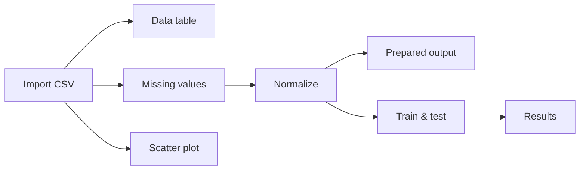

# Visuals and reactive workflow — 26 October 2026

**Latest update:** [Startup and workflow expansion](STARTUP_AND_WORKFLOW_EXPANSION.md) adds explicit independent CSV sources, 56px circles and 38 steps. Earlier size/catalog/source descriptions below document the previous implementation.

**Missing values update — 28 October 2026:** Connecting or selecting Missing values now shows the original input and missing count. Choose a method and press **Impute** in the right settings panel to produce the filled preview and unlock downstream steps. Auto update and Update workflow do not bypass this button. Changing the method, source, upstream preparation, outcome or algorithm requires another Impute click. Moving nodes and inspecting values do not require it again.

The applied preview shows missing input counts before/after and prioritizes missing rows. Numeric inputs use the selected method; categories use the saved category-filling plan. Outcome and excluded columns remain unchanged and their remaining gaps are reported separately. Export output CSV from this step writes the full filled preview. The original CSV and the branch's raw training data remain intact; model fitting learns its own fill values on training records. The Impute preview performs filling alone, so scaling or feature selection from another step does not obscure the result.

Verification: 60 workflow/value-preview/expanded-tool tests passed, including explicit apply, input/method invalidation, five filling methods and preservation of raw data. Embedded acceptance clicks the actual Impute button, checks pending/applied counts and exports the filled preview. Screenshots: `examples/reactive-flow-verified/missing-values-pending.png` and `missing-values-applied.png`.

## Navigation

**Visuals** is now a full main-sidebar option immediately below **My dataset**. The separate Charts & questions entry is consolidated into Visuals, with **Build a chart** and **Ask a question** tabs. Existing question plans, multiple-question review, manual chart controls, outlier/correlation tools and exports remain available. Old links to Charts & questions redirect to the question tab.

**Workflow** is a main-sidebar destination. It opens a searchable, grouped step library on the left and a scrollable dotted canvas on the right. The output/settings drawer opens when a node is clicked; it can be closed to recover canvas space.

## Available steps

| Group | Working steps |
|---|---|
| Data | Import CSV, Data table, Select columns |
| Prepare | Remove duplicates, Missing values, Normalize / scale, Preprocess, Prepared output |
| Visualize | Histogram, Scatter plot, Box plot, Bar chart, Correlation |
| Learn | Train & test, Compare models, Results |

There are 16 step types. This is a functional bounded catalog, not full Orange widget/add-on parity. Each Import CSV node uses the current workspace dataset; independent files per source node and multi-input joins are not implemented.

## Interaction

- Drag a step from the left to position it on the canvas, or click to add it. Drag a round node to reposition it.
- Drag from a right-hand output circle to a compatible left-hand input circle. Click-output then click-input is also supported. Type-incompatible links, duplicate inputs and cycles are rejected.
- Connecting or changing settings triggers **Auto update** by default. Unconnected steps wait; failed predecessors block only their descendants. A separate valid branch can still complete.
- Arrows show direction and animate while the workflow updates. Nodes show ready/waiting/error states. Reduced-motion settings disable the animations.
- Click any step for its actual data, transformed preview, chart, model metrics or comparison. Results accepts a model/comparison output. A fitted model can be activated for the existing prediction/save tools.
- Export a ready step's output to CSV. Data-node export contains the full branch dataframe; Prepared output export contains its explicitly bounded transformed preview (up to 30 training rows). Chart export here is its calculation table. The main Visuals page retains image export.
- Undo canvas edits, remove/disconnect nodes, arrange positions and zoom. Search/collapse the library as needed. Changes to position do not retrain a model. Cached unchanged steps are reused when a downstream setting changes.

## Preparation and safety semantics

Missing values, Normalize and Preprocess carry a **deferred preparation plan**. Data table displays original values at that point; a note explains why filling/scaling is not fitted on the full dataset. Train & test fits each learned transformation on its own training rows and reuses it for the holdout, preserving the existing evaluation guard.

Prepared output is a terminal inspection node. It fits the preparation transforms on a deterministic training partition and shows up to 30 transformed training rows / 30 encoded columns, with full transformed column count and train/test sizes. No predictor is trained by this preview. Without an outcome, all chosen nonexcluded columns are inputs; with an outcome, that column is excluded. Supervised F-test selection needs an outcome. The terminal preview cannot be connected back to a model as if it were leakage-free raw data.

Suggested example:

Choose the training outcome and algorithm in the Train & test settings, or use the current workspace choices. Compare models runs three starting methods for that task with the same split/preparation. Main Train & compare retains its user-selectable methods and parameter search.

## Persistence and limits

Projects save node types, positions, per-node parameters and connections. Incomplete but acyclic canvases can be saved/reopened; node outputs are regenerated. The original imported CSV is preserved, and branch operations do not apply changes to the active dataset versions.

The reactive engine supports up to 60 steps, 120 connections, 20,000 input rows and 300 source columns, with the stricter training/chart-specific budgets still enforced. One compatible parent per input is supported; multi-input model/data wiring and arbitrary scripting are outside this release. CPU work runs in the existing background-worker system; editing settings/links is disabled while a run completes.

## Verification

- **167 automated tests passed**, including branch caching/invalidation, positional changes without refit, actual prepared values, outcome-free preparation preview, independent-branch errors, cycle/type validation, all five chart steps, preservation of the input frame, and node-parameter/incomplete-project reopening. Full output: `examples/reactive-flow-release-pytest.log`.
- Native embedded UI: `python -m mlstudio.flow_smoke`. Evidence: `examples/reactive-flow-verified/result.json`. It exercises a real CSV picker, library drop protocol, native mouse port-to-port connections, auto-run, native node repositioning, prepared output/export, model activation, project serialization and consolidated Visuals navigation. The library drop is an HTML5 DataTransfer event; port linking and node movement use native mouse events.
- Existing offline question-to-result/exports acceptance still passes inside the consolidated Visuals question tab: `examples/visual-requests-verified/result.json`.
- Rebuilt portable executable also passes all nine reactive-canvas acceptance checks with `frozen: true`, launched from Windows TEMP with PYTHONPATH/PYTHONHOME removed: `examples/reactive-flow-portable-verified/result.json`. Process exit code 0. This includes prepared output before an outcome is selected, followed by a configured training/results branch. Bundled source was checked for the current outcome-free preview implementation.
- Final presentation acceptance (ready-step settings folded so output appears first) repeats all nine checks successfully: `examples/reactive-flow-portable-final/result.json`. Source and bundled `flow_canvas.js` hashes match.

The stable project-root EXE is unchanged. The separate portable folder is rebuilt for the new Python workflow engine. Clean-machine testing remains separate from local source/frozen-runtime acceptance.
